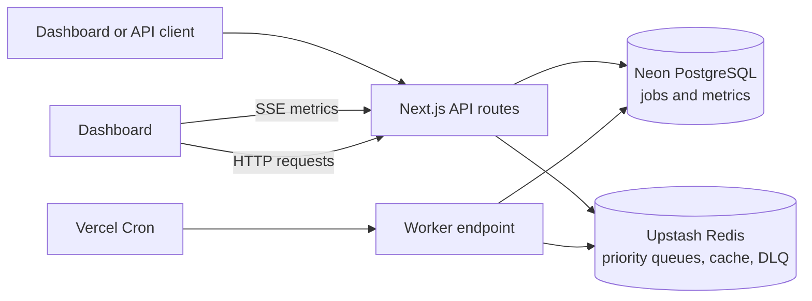

# Software Requirements Specification

## Nexus Distributed Job Orchestration Engine

| Document field | Value |
|---|---|
| Version | 1.0 |
| Status | Baseline specification |
| Date | 26 October 2026 |
| Product | Nexus |

## 1. Introduction

### 1.1 Purpose

This document specifies the functional and quality requirements for Nexus, a web-based job orchestration system. It records the system boundary, user-visible behavior, API contracts, data model, and operating assumptions for the project as implemented in this repository.

### 1.2 Scope

Nexus accepts asynchronous jobs, places them in priority queues, processes them through a scheduled serverless worker, records job state in PostgreSQL, and provides APIs and a dashboard for monitoring activity. Redis provides queueing, caching, rate limiting, and worker heartbeat storage. The worker simulates `compute`, `io`, and `network` work; it is a demonstration workload rather than an executor for arbitrary user code.

The system includes job submission and listing, job status lookup, cancellation of pending jobs, retries, a dead-letter queue (DLQ) with redrive, synthetic load generation, health checks, historical metrics, and a server-sent events (SSE) stream.

### 1.3 Intended audience

This specification is intended for project reviewers, developers, operators deploying Nexus, and users integrating with its HTTP API.

### 1.4 Terms

| Term | Meaning |
|---|---|
| Job | A unit of asynchronous work described by a type, priority, and JSON payload. |
| Worker tick | One invocation of the worker endpoint that checks the queue and processes a batch. |
| Priority queue | A Redis sorted set for jobs at one priority level. |
| DLQ | Redis list holding job IDs that exceeded their retry limit. |
| Heartbeat | A Redis key with a short time-to-live (TTL), used as a liveness signal for the worker. |
| Snapshot | A metrics record persisted to PostgreSQL. |

## 2. Overall Description

### 2.1 Product perspective

Nexus is a single Next.js application containing the dashboard and HTTP API. It relies on external Redis and PostgreSQL services. In the configured Vercel deployment, a cron schedule invokes the worker endpoint once per minute.



### 2.2 Product functions

At a high level, Nexus shall:

1. Validate and accept supported jobs, subject to an IP-based rate limit.
2. Persist job records and place job IDs into a priority-specific Redis queue.
3. Dequeue eligible jobs atomically in critical, normal, then low priority order.
4. Simulate work, update job state, retry transient failures with exponential delay, and promote exhausted jobs to the DLQ.
5. Expose job state, queue/DLQ information, health, and metrics through HTTP APIs.
6. Show queue, throughput, latency, worker liveness, recent jobs, and a synthetic load control on the dashboard.

### 2.3 User classes

| User class | Needs |
|---|---|
| API client | Submit jobs, inspect job state, list jobs, and optionally cancel pending work. |
| Operator | Inspect system health and queue/worker metrics; inspect and redrive DLQ jobs. |
| Demonstration user | View the dashboard and generate synthetic jobs to observe queue behavior. |
| Maintainer | Configure services, deploy the application, and monitor failures. |

The baseline has no user accounts, role management, or tenant separation. API routes are not protected by application authentication.

### 2.4 Operating environment

- Next.js App Router application using TypeScript and React.
- Neon-compatible PostgreSQL accessed through Drizzle ORM.
- Upstash Redis accessed through its REST client.
- Vercel serverless deployment with a cron schedule configured in `vercel.json`.
- Browser with JavaScript and EventSource support for the dashboard's SSE connection.

### 2.5 Constraints and dependencies

- `DATABASE_URL`, `UPSTASH_REDIS_REST_URL`, and `UPSTASH_REDIS_REST_TOKEN` must be configured for the corresponding features to work.
- Job metadata and metric snapshots are persisted in PostgreSQL; queue membership, cached job values, rate-limit data, heartbeat, and DLQ membership use Redis.
- The deployment platform controls serverless execution limits and cron availability.
- Job execution is simulated with fixed delays and a random transient failure; arbitrary user code is not executed.

## 3. Functional Requirements

“Shall” statements define the baseline behavior. Requirement status indicates whether that behavior is present in the current repository.

### 3.1 Job submission and queueing

| ID | Requirement | Status |
|---|---|---|
| FR-ENQ-01 | The system shall accept job types `compute`, `io`, and `network`. | Implemented |
| FR-ENQ-02 | The system shall accept priorities `critical`, `normal`, and `low`; omitted priority shall default to `normal`. | Implemented |
| FR-ENQ-03 | The system shall accept an object payload and default an omitted payload to an empty object. | Implemented |
| FR-ENQ-04 | The system shall reject an invalid enqueue body with HTTP 400 and validation details. | Implemented |
| FR-ENQ-05 | The system shall limit enqueue requests to 20 requests per 10-second sliding window per client IP and return HTTP 429 with rate-limit headers when exceeded. | Implemented |
| FR-ENQ-06 | For an accepted job, the system shall assign a UUID, persist a pending job record, and enqueue its ID at the selected priority. It shall return HTTP 201 with the new ID. | Implemented |
| FR-ENQ-07 | The queue shall dequeue eligible jobs in the order critical, normal, then low, using an atomic Redis script and a batch limit of 10 for a worker tick. | Implemented |
| FR-ENQ-08 | The queue shall defer jobs whose scheduled execution timestamp is in the future. | Implemented |

The enqueue operation writes to PostgreSQL and Redis in sequence; it is not a cross-service transaction. A failure after the database insert may leave a job record that was not queued.

### 3.2 Job processing, retries, and cancellation

| ID | Requirement | Status |
|---|---|---|
| FR-WRK-01 | The worker endpoint shall process no more than 10 job IDs in one tick and shall update a Redis heartbeat with a 65-second TTL when invoked. | Implemented |
| FR-WRK-02 | The worker shall transition eligible jobs to `processing`, simulate work by job type, and record `completed`, completion time, and latency on success. | Implemented |
| FR-WRK-03 | The baseline simulator shall use nominal delays of 1.5 seconds for `compute`, 1 second for `network`, and 0.5 seconds for `io`. | Implemented |
| FR-WRK-04 | On a simulated failure, the worker shall increment the retry count and requeue the job with exponential delay starting at 1 second, doubling for each subsequent retry. The default maximum is three retries. | Implemented |
| FR-WRK-05 | When the retry limit is exceeded, the system shall set the job status to `dead_lettered`, retain an error message, and add its ID to the DLQ. | Implemented |
| FR-WRK-06 | The worker shall process the dequeued batch concurrently and continue its tick after an individual job promise rejects. | Implemented |
| FR-CAN-01 | The cancellation endpoint shall cancel a job only when its current status is `pending`; it shall remove the ID from its priority queue when possible. | Implemented |
| FR-CAN-02 | The cancellation endpoint shall return HTTP 404 for an unknown job and HTTP 400 when the job is not pending. | Implemented |

### 3.3 Job query and DLQ management

| ID | Requirement | Status |
|---|---|---|
| FR-JOB-01 | The system shall return a job by ID and return HTTP 404 when no matching job exists. | Implemented |
| FR-JOB-02 | The system shall use a Redis cache-aside lookup for job reads, with a 30-second cache TTL, and invalidate the cached value when job status is changed through the shared update operation. | Implemented |
| FR-JOB-03 | The job list endpoint shall support optional `status`, `priority`, `cursor`, and `limit` query parameters and return job records with a `nextCursor`. | Implemented |
| FR-DLQ-01 | The system shall expose paginated DLQ jobs and the current DLQ depth. | Implemented |
| FR-DLQ-02 | The system shall redrive a DLQ job by removing it from the DLQ, resetting its retry count and error message, setting it to `pending`, and re-enqueueing it at its stored priority. | Implemented |
| FR-DLQ-03 | The redrive endpoint shall return HTTP 404 if the ID is not present in the DLQ. | Implemented |

### 3.4 Metrics, health, and dashboard

| ID | Requirement | Status |
|---|---|---|
| FR-MET-01 | After a worker tick processes a non-empty batch, the system shall persist a metrics snapshot containing queue depths, processed-job count, average latency, error rate, DLQ depth, cache hit ratio, and recording time. | Implemented |
| FR-MET-02 | The metrics history endpoint shall return snapshots recorded within the requested hour-based window; the default window shall be one hour. | Implemented |
| FR-MET-03 | The metrics stream shall send the latest persisted snapshot and worker heartbeat state as SSE events at approximately two-second intervals while connected. | Implemented |
| FR-MET-04 | The dashboard shall display worker liveness, queue depth, throughput and latency charts, recent jobs, and a control for generating synthetic jobs. | Implemented |
| FR-MET-05 | The health endpoint shall report PostgreSQL, Redis, worker, and queue information and return a structured overall status of `healthy`, `degraded`, or `unhealthy`. | Implemented |
| FR-SIM-01 | The load simulation endpoint shall accept a job count (capped at 500) and priority, generate synthetic jobs with supported types, persist them, and enqueue them. | Implemented |
| FR-SIM-02 | The dashboard shall allow a user to select a job count from 1 to 500 and a priority before starting load simulation. | Implemented |

Metrics are derived from persisted state and Redis counters. The current load simulation endpoint does not implement the `concurrency` input mentioned in an earlier project brief. The current dashboard does not provide dedicated cache-ratio, error-rate, or DLQ statistic panels.

## 4. External Interface Requirements

### 4.1 HTTP API

All endpoints are served by the same application origin and use JSON except for the SSE stream. Unless stated otherwise, unexpected service errors return HTTP 500.

| Method and path | Purpose | Successful response |
|---|---|---|
| `POST /api/jobs/enqueue` | Submit one job; rate limited. | `201` with `{ "id": "<uuid>", "message": "Job enqueued successfully" }` |
| `GET /api/jobs` | List jobs; supports `status`, `priority`, `cursor`, and `limit`. | `200` with `{ "data": [...], "nextCursor": "<uuid-or-null>" }` |
| `GET /api/jobs/{id}` | Read one job via cache-aside. | `200` with the job record |
| `POST /api/jobs/{id}/cancel` | Cancel a pending job. | `200` with a confirmation message |
| `GET /api/jobs/dlq?page={n}&limit={n}` | List dead-lettered jobs. | `200` with `{ "data": [...], "total": n, "page": n, "limit": n }` |
| `POST /api/jobs/dlq/{id}/redrive` | Requeue a DLQ job. | `200` with a confirmation message |
| `POST /api/worker/process` | Execute one worker tick; intended cron target. | `200` with a no-work message or processed count and IDs |
| `POST /api/simulate/load` | Generate synthetic jobs. | `201` with a result message |
| `GET /api/metrics/history?window=1h` | Read persisted snapshots for an hour-based window. | `200` with an array of snapshots |
| `GET /api/metrics/stream` | Receive snapshots and worker liveness over SSE. | `200` `text/event-stream` response |
| `GET /api/health` | Check dependencies and queue state. | `200` when healthy/degraded; `503` when overall status is unhealthy |

Enqueue request example:

```json
{
  "type": "compute",
  "priority": "normal",
  "payload": { "input": 42 }
}
```

Load simulation request example:

```json
{
  "jobCount": 100,
  "priority": "normal"
}
```

### 4.2 Dashboard interface

The dashboard is a browser-based single page at `/`. It uses JSON HTTP requests for job lists and load simulation and an `EventSource` connection for the metrics stream. It reconnects after an SSE error.

### 4.3 Service interfaces

- **PostgreSQL:** job and metrics persistence through Drizzle ORM.
- **Redis:** sorted-set queues, job cache, rate-limit state, heartbeat, counters, and DLQ list.
- **Cron provider:** invokes `POST /api/worker/process` once per minute according to `vercel.json`.

## 5. Data Requirements

### 5.1 Job record

The `jobs` table shall contain:

| Field | Type / rule | Description |
|---|---|---|
| `id` | UUID, primary key | Job identifier. |
| `type` | varchar, required | `compute`, `io`, or `network`. |
| `priority` | varchar, required | `critical`, `normal`, or `low`. |
| `payload` | JSONB, required | Job input object. |
| `status` | varchar, required; defaults to `pending` | `pending`, `processing`, `completed`, `failed`, `cancelled`, or `dead_lettered`. |
| `retry_count` | integer, defaults to 0 | Number of retry attempts. |
| `max_retries` | integer, defaults to 3 | Maximum retry attempts. |
| `error_message` | nullable text | Latest error summary. |
| `created_at`, `updated_at` | timestamps | Creation and most recent state update. |
| `completed_at` | nullable timestamp | Completion time when successful. |
| `latency_ms` | nullable integer | Elapsed execution time for successful jobs. |

### 5.2 Metrics snapshot

The `metrics_snapshots` table shall store an integer ID, recording timestamp, queue depth for each priority, jobs processed in the last minute, average latency in milliseconds, error rate, DLQ depth, and cache hit ratio.

### 5.3 Retention and integrity

The current baseline does not define automated retention or archival. PostgreSQL is the durable source for job records; Redis queue and DLQ membership are operational state. No cross-system transaction is provided for updates spanning PostgreSQL and Redis.

## 6. Non-Functional Requirements

| ID | Requirement |
|---|---|
| NFR-SEC-01 | Redis and database credentials shall be supplied through deployment environment variables and shall not be embedded in application source. |
| NFR-SEC-02 | The enqueue endpoint shall apply the configured sliding-window limit and communicate rate-limit state in response headers. |
| NFR-REL-01 | Redis dequeue shall use a single atomic script so concurrent worker invocations do not claim the same queue entry during dequeue. |
| NFR-REL-02 | Job status reads shall fall back to PostgreSQL on a cache miss and cache the retrieved record for up to 30 seconds. |
| NFR-REL-03 | A worker liveness signal shall expire after 65 seconds without a subsequent heartbeat. |
| NFR-OBS-01 | The system shall expose dependency and worker state through the health API and stream worker liveness to the dashboard. |
| NFR-OBS-02 | The dashboard metrics stream shall use SSE and attempt reconnection after a connection error. |
| NFR-MNT-01 | The application shall be deployable as a Next.js application using the repository's configured build and deployment conventions. |
| NFR-SCL-01 | The load simulation API shall cap a single request at 500 generated jobs. |

No numeric throughput, latency, availability, recovery-time, or retention SLA is defined by the current project baseline. Serverless execution duration and cron cadence depend on the selected deployment plan and provider limits.

## 7. Assumptions, Limitations, and Out of Scope

- Redis and PostgreSQL are reachable and correctly configured for production use.
- The Vercel cron invocation is expected to run once per minute; worker processing can also be invoked manually through its HTTP endpoint.
- The worker route currently has no authorization check. Deployments should account for this when exposing the endpoint.
- Work execution and failure are simulated; Nexus is not a general-purpose sandbox for user-supplied executable code.
- There is no authentication, authorization, tenant isolation, webhook delivery, or user-facing job payload editor in the baseline.
- The system does not provide a distributed transaction across PostgreSQL and Redis, nor an idempotency-key contract for job submission.
- A worker tick that finds no jobs returns before recording a metrics snapshot. Consequently, dashboard snapshots can become stale while the queue is idle.
- The history endpoint returns raw snapshots; it does not aggregate them into larger time buckets.
- The load simulator currently accepts job count and priority; it does not accept concurrency.

## 8. Acceptance Criteria

The baseline is acceptable when the deployed or locally configured system can demonstrate all of the following:

1. A valid enqueue request creates a pending job and returns its UUID; invalid input returns HTTP 400 and a rate-limited request returns HTTP 429.
2. The worker can dequeue and complete supported jobs, update their records, and serve updated state through the job lookup API.
3. A transient job failure is retried with increasing delay, and a job that exceeds its retry limit appears in the DLQ.
4. A pending job can be cancelled; a non-pending job cannot be cancelled through the cancellation API.
5. A DLQ job can be listed and redriven to the normal queue.
6. Health, metrics history, and SSE endpoints return their documented response formats when dependencies are configured.
7. The dashboard displays queue and job activity, worker liveness, and can trigger a bounded synthetic load run.

---

*End of document.*
